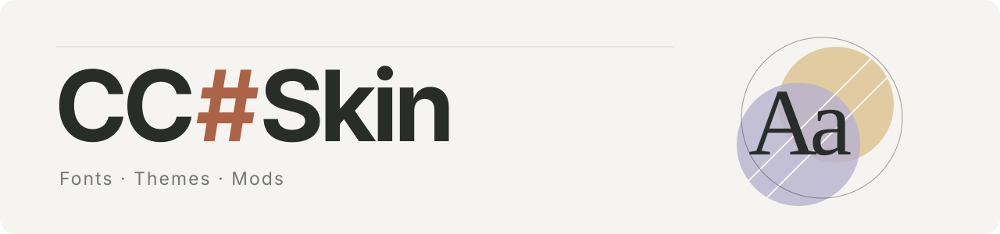
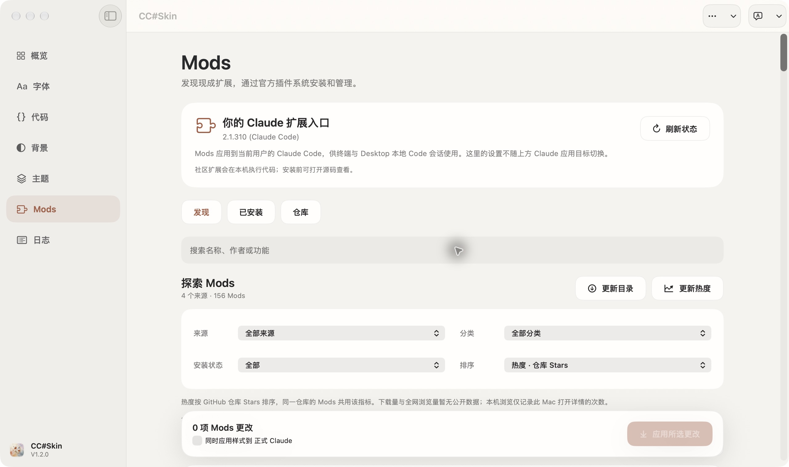

<picture>
  <source media="(prefers-color-scheme: dark)" srcset="docs/assets/header-dark.svg">
  
</picture>

Customize Claude's fonts and colors. Manage Claude Code Mods.

  <a href="https://github.com/Orxooo/CCSkin/releases/download/v1.2.0/CCSkin-1.2.0-macOS-arm64.zip"><b>Download for macOS</b></a>　·　
  <a href="README.md">简体中文</a>　·　
  <a href="CHANGELOG.en.md">Changelog</a>

macOS 26+ · Apple Silicon · 1.2.0

## Features

- **Typography**: Set Chinese, English, interface and code fonts; adjust size, line height and reading width.
- **Colors and themes**: Choose light backgrounds and dark themes. Save combinations or import a theme.
- **Mods**: Browse 156 entries from four sources. Search, filter, sort, add repositories and manage plugins.

Show Mods

 

## Install

1. Download the ZIP, extract it and move `CC#Skin.app` to Applications.
2. Open the app and check App Management access in Overview.
3. Select Claude, adjust your settings, then quit Claude before applying them.

The app is signed but not Apple-notarized. See the [user guide](docs/USAGE.md#installation-and-checksums) for first launch, checksums and upgrades.

## Use

**Appearance**: The app backs up Claude before changing it. To undo, quit Claude and choose Restore app in More actions. Recheck compatibility after Claude updates.

**Mods**: Requires Claude Code CLI 2.1.287+. Queue operations, apply them, then run `/reload-plugins` or reopen the Code session. Community Mods run local code; inspect their source before installing. [Sources and ranking](docs/MODS.md)

## Documentation

[User guide](docs/USAGE.md) · [Mods](docs/MODS.md) · [Build and CLI](docs/DEVELOPMENT.md) · [Verification](docs/VERIFICATION.md) · [Contributing](CONTRIBUTING.md)

---

[GPL-3.0-only](LICENSE) · © 2026 Orxooo · Independent of Anthropic. [Notice](NOTICE)
